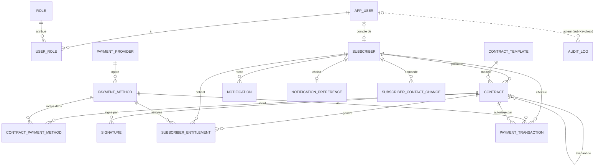

# 02 — Modèle de données

Semaine 1 · Cadrage, mis à jour le 05/11/2026 (migrations V1 à V17). Base PostgreSQL 16, migrations Flyway
(`backend/src/main/resources/db/migration`).

Conventions :

- Clés primaires `uuid` (générées par l'application), sauf `audit_log` (`bigint` identity, volume élevé).
- Noms de tables et colonnes en `snake_case`, au singulier.
- Montants en `numeric(15,2)`, devise ISO 4217 (`MRU` par défaut).
- Horodatages en `timestamptz` ; les dates de validité de contrat en `date`, interprétées dans le fuseau `Africa/Nouakchott` (UTC+0).
- Statuts stockés en `varchar` + contrainte `CHECK` (lisibles, faciles à faire évoluer).
- Colonne `version` (verrouillage optimiste JPA) sur les tables modifiées par plusieurs acteurs.
- Aucune donnée de carte (PAN, CVV) ni aucun secret fournisseur en base.
- Identifiants officiels (NNI, NIF) **chiffrés** en base (AES-256-GCM, D30) ; l'unicité porte sur une empreinte HMAC.

## Diagramme

## Entités

### 1. `app_user` — compte d'authentification

Le mot de passe et le MFA sont gérés par **Keycloak** : la table locale ne fait que relier l'identité Keycloak au domaine.

| Colonne | Type | Contraintes |
|---------|------|-------------|
| id | uuid | PK |
| keycloak_id | varchar(64) | unique, not null (claim `sub` du JWT) |
| email | varchar(254) | unique, not null |
| phone | varchar(20) | |
| full_name | varchar(200) | not null |
| status | varchar(20) | `ACTIVE`, `DISABLED` |
| last_login_at | timestamptz | |
| created_at / updated_at | timestamptz | not null |

### 2. `role` et `user_role` — rôles

| Table | Colonnes |
|-------|----------|
| role | id (smallint PK), code (`ADMIN`, `ABONNE`, unique), label |
| user_role | user_id → app_user, role_id → role ; PK (user_id, role_id) |

Les rôles font foi dans Keycloak (realm roles) ; cette copie sert aux requêtes et à l'audit.

### 3. `subscriber` — abonné

| Colonne | Type | Contraintes |
|---------|------|-------------|
| id | uuid | PK |
| reference | varchar(20) | unique, `ABN-0001` (séquence `subscriber_ref_seq`) |
| type | varchar(10) | `PHYSIQUE`, `MORALE` |
| display_name | varchar(200) | nom ou raison sociale |
| nni | varchar(200) | personne physique : 10 chiffres, **chiffré** (`v1:…`, AES-256-GCM) |
| nif | varchar(200) | personne morale, **chiffré** |
| nni_hash / nif_hash | char(64) | empreinte HMAC-SHA256 : index uniques (doublons refusés sans déchiffrer) |
| phone | varchar(20) | not null, format `+222XXXXXXXX` |
| email | varchar(254) | unique, not null |
| address | varchar(300) | |
| status | varchar(20) | `PENDING`, `ACTIVE`, `SUSPENDED`, `DISABLED` |
| user_id | uuid | → app_user, unique |
| created_at / updated_at / version | | |

Contrainte : `(type = 'PHYSIQUE' AND nni IS NOT NULL) OR (type = 'MORALE' AND nif IS NOT NULL)` ; `nni_hash` et `nif_hash`
uniques lorsqu'ils sont renseignés. Le format (10 chiffres, 8 chiffres) est vérifié par l'application avant chiffrement.

### 4. `payment_provider` — fournisseur technique

| Colonne | Type | Contraintes |
|---------|------|-------------|
| id | uuid | PK |
| code | varchar(30) | unique : `BANKILY`, `MASRVI`, `VISA_GATEWAY` |
| name | varchar(100) | |
| kind | varchar(10) | `WALLET`, `CARD` : type des moyens rattachés (V14) |
| base_url | varchar(300) | URL de l'API (simulateur ou réelle) |
| credentials_ref | varchar(200) | **référence** vers le secret (clé de config / chemin Vault), jamais la valeur |
| status | varchar(20) | `ENABLED` (raccordé : un adaptateur existe), `DISABLED` (Sedad) |
| health_status | varchar(20) | `UP`, `DOWN`, `UNKNOWN` |
| last_health_check_at | timestamptz | |

### 5. `payment_method` — moyen de paiement (catalogue)

| Colonne | Type | Contraintes |
|---------|------|-------------|
| id | uuid | PK |
| code | varchar(30) | unique, `^[A-Z][A-Z0-9_]{1,29}# 02 — Modèle de données

Semaine 1 · Cadrage, mis à jour le 05/11/2026 (migrations V1 à V17). Base PostgreSQL 16, migrations Flyway
(`backend/src/main/resources/db/migration`).

Conventions :

- Clés primaires `uuid` (générées par l'application), sauf `audit_log` (`bigint` identity, volume élevé).
- Noms de tables et colonnes en `snake_case`, au singulier.
- Montants en `numeric(15,2)`, devise ISO 4217 (`MRU` par défaut).
- Horodatages en `timestamptz` ; les dates de validité de contrat en `date`, interprétées dans le fuseau `Africa/Nouakchott` (UTC+0).
- Statuts stockés en `varchar` + contrainte `CHECK` (lisibles, faciles à faire évoluer).
- Colonne `version` (verrouillage optimiste JPA) sur les tables modifiées par plusieurs acteurs.
- Aucune donnée de carte (PAN, CVV) ni aucun secret fournisseur en base.
- Identifiants officiels (NNI, NIF) **chiffrés** en base (AES-256-GCM, D30) ; l'unicité porte sur une empreinte HMAC.

## Diagramme

## Entités

### 1. `app_user` — compte d'authentification

Le mot de passe et le MFA sont gérés par **Keycloak** : la table locale ne fait que relier l'identité Keycloak au domaine.

| Colonne | Type | Contraintes |
|---------|------|-------------|
| id | uuid | PK |
| keycloak_id | varchar(64) | unique, not null (claim `sub` du JWT) |
| email | varchar(254) | unique, not null |
| phone | varchar(20) | |
| full_name | varchar(200) | not null |
| status | varchar(20) | `ACTIVE`, `DISABLED` |
| last_login_at | timestamptz | |
| created_at / updated_at | timestamptz | not null |

### 2. `role` et `user_role` — rôles

| Table | Colonnes |
|-------|----------|
| role | id (smallint PK), code (`ADMIN`, `ABONNE`, unique), label |
| user_role | user_id → app_user, role_id → role ; PK (user_id, role_id) |

Les rôles font foi dans Keycloak (realm roles) ; cette copie sert aux requêtes et à l'audit.

### 3. `subscriber` — abonné

| Colonne | Type | Contraintes |
|---------|------|-------------|
| id | uuid | PK |
| reference | varchar(20) | unique, `ABN-0001` (séquence `subscriber_ref_seq`) |
| type | varchar(10) | `PHYSIQUE`, `MORALE` |
| display_name | varchar(200) | nom ou raison sociale |
| nni | varchar(200) | personne physique : 10 chiffres, **chiffré** (`v1:…`, AES-256-GCM) |
| nif | varchar(200) | personne morale, **chiffré** |
| nni_hash / nif_hash | char(64) | empreinte HMAC-SHA256 : index uniques (doublons refusés sans déchiffrer) |
| phone | varchar(20) | not null, format `+222XXXXXXXX` |
| email | varchar(254) | unique, not null |
| address | varchar(300) | |
| status | varchar(20) | `PENDING`, `ACTIVE`, `SUSPENDED`, `DISABLED` |
| user_id | uuid | → app_user, unique |
| created_at / updated_at / version | | |

Contrainte : `(type = 'PHYSIQUE' AND nni IS NOT NULL) OR (type = 'MORALE' AND nif IS NOT NULL)` ; `nni_hash` et `nif_hash`
uniques lorsqu'ils sont renseignés. Le format (10 chiffres, 8 chiffres) est vérifié par l'application avant chiffrement.

### 4. `payment_provider` — fournisseur technique

| Colonne | Type | Contraintes |
|---------|------|-------------|
| id | uuid | PK |
| code | varchar(30) | unique : `BANKILY`, `MASRVI`, `VISA_GATEWAY` |
| name | varchar(100) | |
| kind | varchar(10) | `WALLET`, `CARD` : type des moyens rattachés (V14) |
| base_url | varchar(300) | URL de l'API (simulateur ou réelle) |
| credentials_ref | varchar(200) | **référence** vers le secret (clé de config / chemin Vault), jamais la valeur |
| status | varchar(20) | `ENABLED` (raccordé : un adaptateur existe), `DISABLED` (Sedad) |
| health_status | varchar(20) | `UP`, `DOWN`, `UNKNOWN` |
| last_health_check_at | timestamptz | |

### 5. `payment_method` — moyen de paiement (catalogue)

| Colonne | Type | Contraintes |
|---------|------|-------------|
| id | uuid | PK |
 : `BANKILY`, `MASRVI`, `VISA`… (fixé à la création) |
| name | varchar(100) | |
| category | varchar(10) | `WALLET`, `CARD` (celui du fournisseur) |
| provider_id | uuid | → payment_provider, not null |
| short_label | varchar(4) | pastille : `BK`, `MS`, `VI` |
| color | varchar(7) | `#2563EB`… |
| logo_object_key / logo_content_type / logo_updated_at | | logo dans le stockage S3 (PNG, JPEG, WebP ; optionnel) |
| description / instructions | text | affichés à l'abonné |
| conditions | text | conditions d'utilisation (wallet) ou règles d'acceptation (carte), affichées à l'abonné (V14) |
| currency | char(3) | `MRU` |
| status | varchar(20) | `ACTIVE`, `INACTIVE` |

### 6. `contract_template` — modèle de contrat

| Colonne | Type | Contraintes |
|---------|------|-------------|
| id | uuid | PK |
| code | varchar(50) | ex. `STANDARD` |
| name | varchar(100) | « Contrat standard » |
| version | int | unique (code, version) |
| content_html | text | modèle Thymeleaf |
| status | varchar(20) | `ACTIVE`, `ARCHIVED` |
| created_at | timestamptz | |

### 7. `contract` — contrat

| Colonne | Type | Contraintes |
|---------|------|-------------|
| id | uuid | PK |
| reference | varchar(20) | unique, `CTR-2026-0001` ; avenants `CTR-2026-0001-A1`, `-A2`… |
| subscriber_id | uuid | → subscriber, not null |
| template_id | uuid | → contract_template, not null |
| parent_contract_id | uuid | → contract : contrat que cet avenant remplace (D29) |
| amendment_number | int | 0 pour le contrat initial, n pour l'avenant n°n (V15) |
| status | varchar(30) | `DRAFT`, `PENDING_SIGNATURE`, `SIGNED`, `ACTIVE`, `SUSPENDED`, `EXPIRED`, `TERMINATED`, `REPLACED` (remplacé par un avenant activé) |
| start_date / end_date | date | `end_date >= start_date` |
| commission_rate | numeric(5,2) | optionnel |
| pdf_object_key / pdf_sha256 | varchar | PDF généré (stockage S3) et son empreinte |
| signed_pdf_object_key / signed_pdf_sha256 | varchar | PDF scellé PAdES |
| sent_at, signed_at, activated_at, terminated_at | timestamptz | |
| termination_reason | varchar(300) | |
| created_by | varchar(254) | email de l’administrateur (libellé d’audit) |
| created_at / updated_at / version | | |

**Un seul contrat actif par abonné** (hypothèse retenue) : index unique partiel
`UNIQUE (subscriber_id) WHERE status IN ('ACTIVE', 'SUSPENDED')`. Un avenant coexiste avec le contrat qu'il remplace
tant qu'il n'est pas activé ; à l'activation, l'original passe `REPLACED` avant l'activation de l'avenant (même transaction).

### 8. `contract_payment_method` — moyens inclus dans un contrat

| Colonne | Type | Contraintes |
|---------|------|-------------|
| contract_id | uuid | → contract, PK |
| payment_method_id | uuid | → payment_method, PK |
| per_transaction_limit | numeric(15,2) | > 0 |
| monthly_limit | numeric(15,2) | ≥ per_transaction_limit |

### 9. `signature` — tentative et preuve de signature

| Colonne | Type | Contraintes |
|---------|------|-------------|
| id | uuid | PK |
| contract_id | uuid | → contract |
| signer_user_id | uuid | → app_user |
| method | varchar(20) | `OTP_EMAIL` (puis `OTP_SMS`, `EXTERNAL`) |
| otp_hash | varchar(100) | hash du code (jamais le code en clair) |
| otp_expires_at | timestamptz | création + 5 min |
| otp_attempts | smallint | ≤ 3 (remis à zéro à chaque nouveau code) |
| otp_sent_count / otp_last_sent_at | smallint / timestamptz | renvoi après 60 s, 5 envois au maximum |
| status | varchar(20) | `PENDING`, `SIGNED`, `FAILED`, `EXPIRED`, `CANCELLED` ; une seule `PENDING` et une seule `SIGNED` par contrat |
| document_sha256 | char(64) | empreinte du PDF présenté |
| signed_document_sha256 | char(64) | empreinte du PDF scellé |
| signed_at | timestamptz | |
| ip_address | inet | |
| user_agent | varchar(300) | |
| created_at | timestamptz | |

### 10. `subscriber_entitlement` — droit calculé

| Colonne | Type | Contraintes |
|---------|------|-------------|
| id | uuid | PK |
| subscriber_id | uuid | → subscriber |
| contract_id | uuid | → contract |
| payment_method_id | uuid | → payment_method |
| valid_from / valid_to | date | copie des dates du contrat |
| per_transaction_limit / monthly_limit | numeric(15,2) | copie des plafonds du contrat (figés à la signature) |
| status | varchar(20) | `ACTIVE`, `SUSPENDED`, `REVOKED`, `EXPIRED` |
| activated_at / revoked_at | timestamptz | |
| revoke_reason | varchar(300) | |

**Idempotence** : `UNIQUE (contract_id, payment_method_id)` — rejouer l'activation ne crée aucun doublon (`INSERT … ON CONFLICT DO NOTHING`).

### 11. `payment_transaction` — transaction

(`transaction` est un mot réservé SQL, d'où le nom.)

| Colonne | Type | Contraintes |
|---------|------|-------------|
| id | uuid | PK |
| reference | varchar(20) | unique, `TRX-000148` |
| subscriber_id | uuid | → subscriber |
| payment_method_id | uuid | → payment_method |
| contract_id | uuid | → contract (contrat ayant autorisé l'accès) |
| amount | numeric(15,2) | > 0 |
| currency | char(3) | `MRU` |
| status | varchar(20) | interne : `CREATED`, `PENDING`, `SUCCEEDED`, `FAILED`, `CANCELLED`, `REFUNDED` |
| provider_status | varchar(50) | statut brut du fournisseur |
| provider_reference | varchar(100) | id côté fournisseur |
| idempotency_key | varchar(100) | not null |
| payer_phone | varchar(20) | wallets uniquement |
| card_masked_pan | varchar(19) | `411111******1111` (Visa) — jamais le PAN complet |
| failure_code / failure_message | varchar | |
| receipt_object_key | varchar(300) | reçu PDF dans le stockage S3 |
| created_at / updated_at / completed_at / version | | |

Contraintes : `UNIQUE (subscriber_id, idempotency_key)` ; `UNIQUE (payment_method_id, provider_reference)`.

### 12. `notification`

| Colonne | Type | Contraintes |
|---------|------|-------------|
| id | uuid | PK |
| subscriber_id | uuid | → subscriber (nullable) |
| channel | varchar(10) | `EMAIL`, `SMS`, `IN_APP` |
| recipient | varchar(254) | |
| template | varchar(50) | `CONTRACT_AVAILABLE`, `CONTRACT_ACTIVATED`, `PAYMENT_SUCCEEDED`… |
| subject / body | text | |
| status | varchar(20) | `QUEUED`, `SENT`, `FAILED` |
| error | varchar(500) | |
| read_at, created_at, sent_at | timestamptz | |

### 13. `audit_log`

| Colonne | Type | Contraintes |
|---------|------|-------------|
| id | bigint | PK identity |
| occurred_at | timestamptz | not null |
| actor_subject | varchar(64) | identifiant Keycloak (`sub`), sans clé étrangère pour que l’audit n’échoue jamais (null : système) |
| actor_label | varchar(254) | email ou `SYSTEM` |
| action | varchar(50) | `LOGIN`, `SUBSCRIBER_CREATED`, `CONTRACT_SENT`… |
| resource_type / resource_id | varchar | |
| outcome | varchar(10) | `SUCCESS`, `FAILURE` |
| ip_address | inet | |
| details | jsonb | sans secret ni donnée de carte |

Table en ajout seul (pas de `UPDATE`/`DELETE` par l'application).

### Tables ajoutées en cours de projet

| Table | Rôle | Migration |
|-------|------|-----------|
| `notification_preference` | Préférence de l'abonné : emails de fin de paiement (les emails de contrat et les codes partent toujours) | V12 |
| `subscriber_contact_change` | Changement de téléphone / adresse par l'abonné en attente du code email : nouvelles valeurs, HMAC du code, expiration (5 min), essais (3), statut `PENDING`, `CONFIRMED`, `CANCELLED`, `EXPIRED`, `BLOCKED` | V13 |

## Tables techniques (hors des 13 entités)

| Table | Rôle | Semaine |
|-------|------|---------|
| `webhook_event` | Anti-rejeu : `UNIQUE (provider_code, event_id)` + horodatage de réception | S8 |
| `shedlock` | Verrou des jobs planifiés (ShedLock) | S7 |
| `event_publication` | Registre des événements Spring Modulith (ajouté avec les premiers événements inter-modules) | S7 |

## Ordre des migrations prévu

| Migration | Contenu | Semaine |
|-----------|---------|---------|
| `V1__users_roles_subscribers.sql` | app_user, role, user_role, subscriber | S2 |
| `V2__audit_log.sql` | audit_log | S3 |
| `V3__payment_catalog.sql` | payment_provider, payment_method + données Bankily / Masrvi / Visa | S4 |
| `V4__contracts.sql` | contract_template, contract, contract_payment_method | S5 |
| `V5__signature.sql` | signature | S6 |
| `V6__entitlements.sql` | subscriber_entitlement, shedlock | S7 |
| `V7__webhooks.sql` | webhook_event | S8 |
| `V8__catalog_logos.sql` | logos des moyens ; Sedad et Mastercard (désactivés) | S9 |
| `V9__transactions.sql` | payment_transaction | S9 |
| `V10__notifications.sql` | notification | S11 |
| `V11__masrvi_color.sql` | couleur Masrvi distincte dans les graphiques | S11 |
| `V12__notification_preferences.sql` | notification_preference | S11 |
| `V13__contact_changes.sql` | subscriber_contact_change | S12 |
| `V14__catalog_management.sql` | payment_provider.kind, payment_method.conditions, format du code | S12 |
| `V15__contract_amendments.sql` | statut `REPLACED`, amendment_number, modèle « Avenant n°… » | S12 |
| `V16__encrypted_identifiers.sql` | NNI / NIF chiffrés, empreintes nni_hash / nif_hash | S12 |
| `V17__transaction_commission.sql` | Taux et montant de commission figés sur les transactions | S12 |
